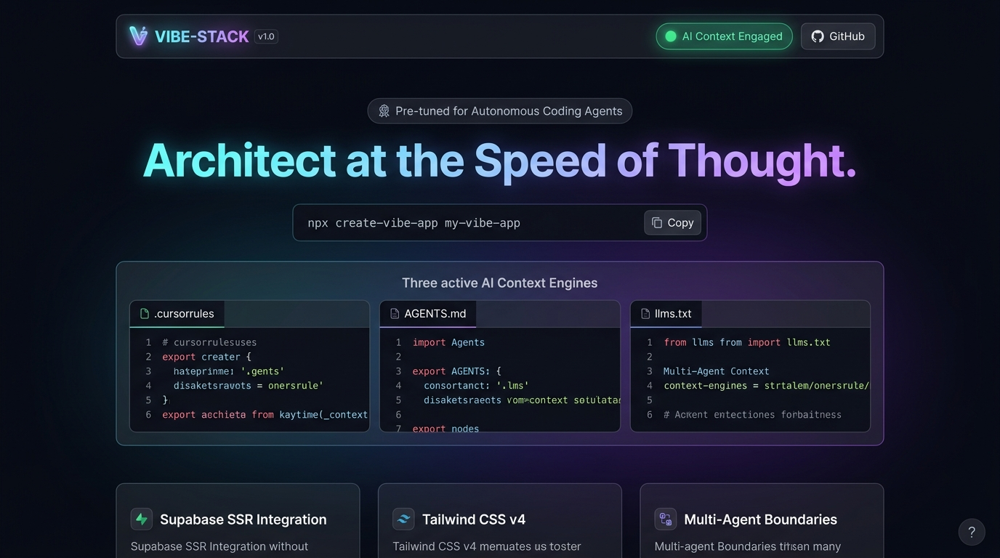
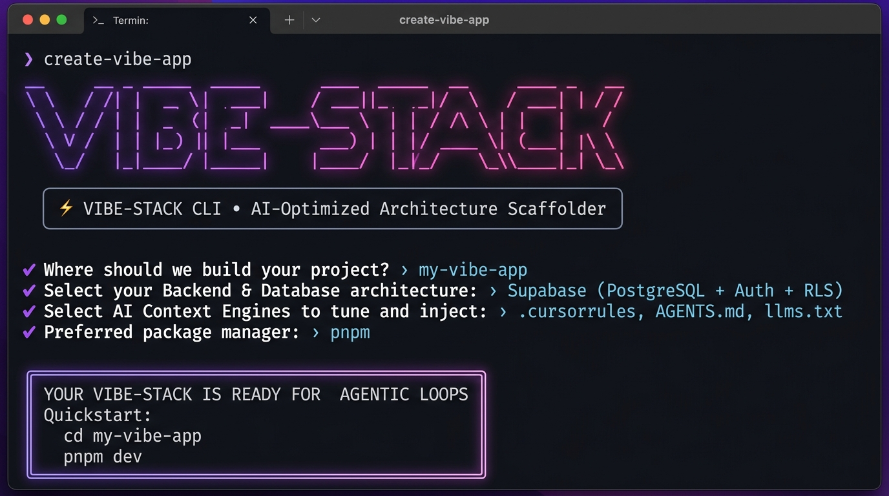
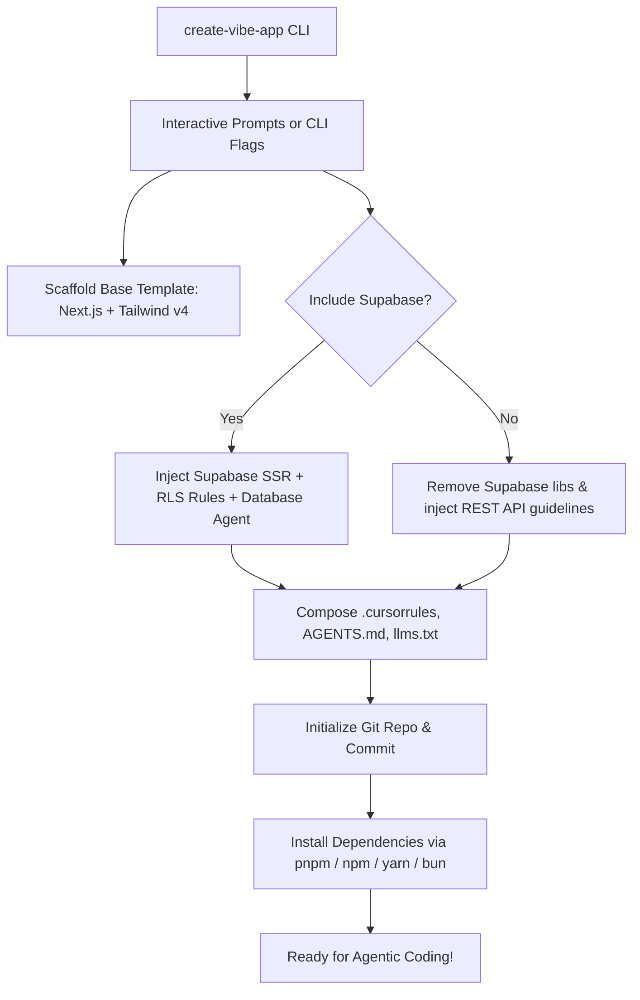

# ⚡ Vibe-Stack (`create-vibe-app`)

<div align="center">

[](https://opensource.org/licenses/MIT)
[](https://nodejs.org/)
[](https://nextjs.org/)
[](https://tailwindcss.com/)
[](https://supabase.com/)
[](https://cursor.com/)

**A highly polished CLI that scaffolds production-ready, AI-optimized codebases with pre-tuned context configurations.**

[Quickstart](#-quickstart) • [UI Preview](#-ui-preview) • [Architecture](#-directory-structure) • [Context Engines](#-context-engines-deep-dive) • [CLI Options](#-cli-flags--options)

</div>

---

## 📸 UI & Terminal Preview

### 🌐 Next.js 16 + Tailwind v4 + AI Context Web UI


### 💻 Interactive Scaffolding CLI Experience


---

## 💡 Why Vibe-Stack?

Traditional starter kits give you frontend boilerplate, but they leave your AI coding agents completely blind. AI agents hallucinate outdated dependencies, mix server and client component logic, bypass database Row Level Security (RLS), and produce spaghetti code when switching contexts.

**Vibe-Stack solves this at the architectural root.** 

When you scaffold a project with `create-vibe-app`, the CLI dynamically generates and injects targeted **Context Engines** (`.cursorrules`, `AGENTS.md`, and `llms.txt`) tuned precisely to your chosen stack (Next.js 16 + Tailwind v4 + Supabase). Your AI editor (Cursor, Windsurf, Copilot, or Claude Code) immediately acts like a senior staff engineer with full domain awareness from minute one.

---

## 📂 Directory Structure

```text
vibe-stack/
├── bin/
│   └── cli.js                  # CLI entry point (arg parsing & orchestration)
├── templates/
│   ├── base-next/              # Next.js 16 + Tailwind v4 + Supabase layout
│   │   ├── app/
│   │   │   ├── api/health/     # Health check & system status route
│   │   │   ├── globals.css     # Tailwind v4 theme tokens & glassmorphic styles
│   │   │   ├── layout.tsx      # Root layout with dark mode tokens
│   │   │   └── page.tsx        # High-impact interactive stack showcase
│   │   ├── components/         # Modular RSC & interactive client leaves
│   │   ├── lib/
│   │   │   ├── supabase/       # Browser, Server (SSR), and Middleware clients
│   │   │   └── utils.ts        # Dynamic className merger (clsx + twMerge)
│   │   └── types/              # Strongly-typed database contracts
│   └── ai-config/              # Target folder for context engines
│       ├── llms.txt            # Semantic definition of the stack for external LLMs
│       ├── .cursorrules        # High-density operational rules for agentic loops
│       └── AGENTS.md           # Multi-agent role division and execution boundaries
├── src/
│   ├── core/
│   │   ├── installer.js        # Handles npm/pnpm/yarn/bun dependency mapping & git
│   │   └── dynamic-injector.js # Optimizes context injection based on selected flags
│   └── utils/
│       └── ui-terminal.js      # Ora spinners, Chalk themes, and gradient headers
├── package.json
└── README.md
```

---

## ⚡ Quickstart

Create a new AI-optimized application in seconds:

```bash
# Using npx (zero installation required)
npx create-vibe-app my-vibe-app

# Or using pnpm
pnpm dlx create-vibe-app my-vibe-app

# Or using bun
bunx create-vibe-app my-vibe-app
```

Then navigate into your project and boot up the development server:

```bash
cd my-vibe-app
npm run dev
```

---

## 🧠 Context Engines Deep Dive

Vibe-Stack injects three interconnected context layers directly into your project root:

### 1. `.cursorrules` — High-Density Operational Directives
Tuned specifically for agentic loops in Cursor, Windsurf, and modern IDEs:
- **Strict Server Component Boundaries**: Enforces RSC by default and prevents unwarranted `'use client'` leaks.
- **Supabase SSR Compliance**: Mandates `createClient()` from `@/lib/supabase/server` for server components and `@/lib/supabase/client` for client components.
- **PostgreSQL Row Level Security**: Mandates that every table has explicit RLS policies for `SELECT`, `INSERT`, `UPDATE`, and `DELETE`.
- **Atomic Modification Loop**: Instructs agents to perform surgical diffs rather than full-file rewrites.

### 2. `AGENTS.md` — Multi-Agent Role Boundaries
Organizes autonomous workflows into specialized, non-overlapping personas:
- **`@architect` (System Architect)**: System hierarchy, dependency graph, API contracts, and schema invariants.
- **`@frontend` (UI / Tailwind v4 Specialist)**: React 19 components, accessibility, responsive design, and glassmorphic micro-interactions.
- **`@database` (Database & Backend Engineer)**: Supabase schemas, SQL migrations, Row Level Security (RLS), and typed database helpers.
- **`@qa` (Security & QA Auditor)**: Type soundness, regression prevention, zero credential leakage, and edge case tests.

### 3. `llms.txt` — Semantic Stack Map
Adheres to the official [`llms.txt`](https://llmstxt.org) standard:
- Provides external LLM scrapers and agent systems with an instantaneous, high-level map of project paths, database schemas, environment variables, and design rules without parsing gigabytes of dependencies.

---

## 🔧 Dynamic Context Injection Engine

The `dynamic-injector.js` engine reads your chosen flags and dynamically tailors the context files:



---

## ⚙️ CLI Flags & Options

You can run `create-vibe-app` completely headless in CI/CD or scripted environments using flags:

| Flag | Type | Default | Description |
| :--- | :--- | :--- | :--- |
| `[project-directory]` | `string` | Prompted | Name of the directory to scaffold |
| `-t, --template <name>` | `string` | `base-next` | Scaffold from a specific template |
| `--supabase` | `boolean` | `true` | Include Supabase SSR, client/server helpers, & RLS context |
| `--no-supabase` | `boolean` | `false` | Exclude Supabase and scaffold clean REST API architecture |
| `--tailwind` | `boolean` | `true` | Include Tailwind CSS v4 design tokens and configuration |
| `--ai-context` | `boolean` | `true` | Generate pre-tuned `.cursorrules`, `AGENTS.md`, and `llms.txt` |
| `--no-ai-context` | `boolean` | `false` | Skip generating AI context files |
| `-p, --package-manager <pm>` | `string` | Auto-detect | Force package manager (`npm`, `pnpm`, `yarn`, `bun`) |
| `--install` / `--no-install` | `boolean` | `true` | Enable or skip automatic dependency installation |
| `--git` / `--no-git` | `boolean` | `true` | Enable or skip git repository initialization |
| `-y, --yes` | `boolean` | `false` | Non-interactive mode accepting all defaults |
| `-v, --version` | `boolean` | - | Display current version |
| `-h, --help` | `boolean` | - | Display help menu |

### Example Headless Commands:

```bash
# Minimal lightweight setup without Supabase
npx create-vibe-app my-site --yes --no-supabase

# Scaffolding with pnpm and skipping git initialization
npx create-vibe-app saas-app --yes -p pnpm --no-git
```

---

## 🧪 Testing

The repository contains an automated test suite verifying both full and minimal scaffolding:

```bash
npm test
```

---

## 🛡️ License

MIT License © 2026
Built with passion for the autonomous coding revolution.
